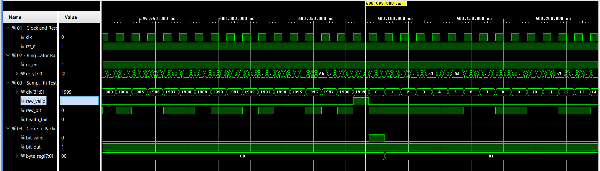
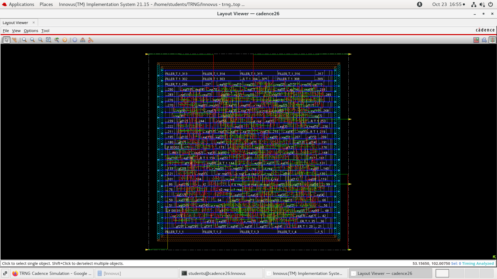

# Ring-Oscillator True Random Number Generator

A hardware true random number generator (TRNG) designed in Verilog and carried from RTL through FPGA implementation and ASIC physical design.


## What This Project Builds

Eight ring oscillators produce raw jitter-based transitions. Their combined output passes through asynchronous sampling, health monitoring, bit conditioning, byte packing, and UART transmission:

**Ring oscillators → XOR → 2-flop sampler → RCT/APT health checks → Von Neumann corrector → UART**

The project connects three workflows:

- **FPGA:** Xilinx Vivado implementation and timing/power analysis
- **SKY130 ASIC:** OpenLane synthesis and place-and-route
- **90 nm ASIC:** Cadence Genus/Innovus implementation

## Architecture

| Stage | Purpose |
|---|---|
| Ring-oscillator bank | Generates an entropy source from oscillator jitter |
| XOR and asynchronous sampler | Combines oscillator transitions and captures raw samples |
| RCT and APT health checks | Monitors repetition and adaptive-proportion behavior |
| Von Neumann corrector | Removes simple first-order pairing bias |
| Byte packer | Forms output bytes from accepted random bits |
| UART 8-N-1 | Transmits random bytes to an external system |

## Implementation Results

### FPGA — Xilinx Vivado



| Metric | Result |
|---|---:|
| Worst setup slack | +2.858 ns |
| Worst hold slack | +0.106 ns |
| Worst pulse-width slack | +4.500 ns |
| Total on-chip power | 73 mW, estimated |

A 100 MHz clock constraint was used. All reported setup, hold, and pulse-width endpoints met their constraints in this run.

### SKY130 ASIC — OpenLane

| Metric | Result |
|---|---:|
| Process / library | SKY130A / sky130_fd_sc_hd |
| Clock constraint | 10 ns / 100 MHz |
| Final setup / hold slack | +5.86 ns / +0.29 ns |
| Final utilization | 47.77% |
| Typical-corner power | 1.34 mW |
| Magic DRC | 0 violations |
| LVS | 0 mismatches |

The SKY130 GDSII deliverable is [`trng_layout.gds`](openlane/physical/trng_layout.gds).

### 90 nm ASIC — Cadence



| Metric | Result |
|---|---:|
| Tools | Genus 21.14 / Innovus 21.15 |
| Process / supply | 90 nm / 0.9 V |
| Top-level instances | 679 |
| Reported setup slack | +6.009 ns |
| Post-route power | 0.37239906 mW, estimated |

## NIST SP 800-22 Evaluation

The captured statistical testing campaign processed:

- **55 binary bitstreams**
- **1,000,000 bits per stream**
- **55,000,000 bits in total**

The Frequency, Block Frequency, Cumulative Sums, Longest Run, FFT, Universal, Serial, and Linear Complexity families all reported 55/55 passes in the captured table. One NonOverlapping Template row was reported at 51/55, below the approximate 52/55 proportion threshold.

NIST SP 800-22 is used here as statistical screening rather than as proof of an entropy source or certification of cryptographic suitability.

## Reproduce the Functional Simulation

Icarus Verilog:

```bash
iverilog -g2012 -DTRNG_BEHAV_SIM -s tb_trng_top \
  -o trng_sim openlane/src/trng_tech_cells.v \
  openlane/src/trng_top.v verification/tb_trng_top_rtl.v
vvp trng_sim
```

This command performs a functional behavioral check. It does not model physical entropy or establish randomness quality.

OpenLane reruns require SKY130A PDK support. Cadence reruns require matching Genus/Innovus libraries and licenses.

## Project Files

- [`rtl/trng_top.v`](rtl/trng_top.v) — FPGA Verilog implementation
- [`openlane/src/trng_top.v`](openlane/src/trng_top.v) — SKY130 physical-design RTL
- [`openlane/physical/trng_layout.gds`](openlane/physical/trng_layout.gds) — SKY130 GDSII layout
- [`results/nist/nist_sp80022_summary.txt`](results/nist/nist_sp80022_summary.txt) — NIST campaign summary

## License

Released under the [MIT License](LICENSE).
