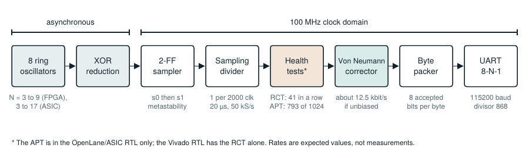
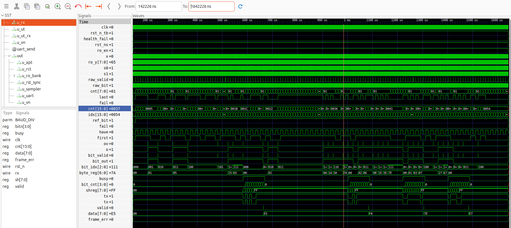
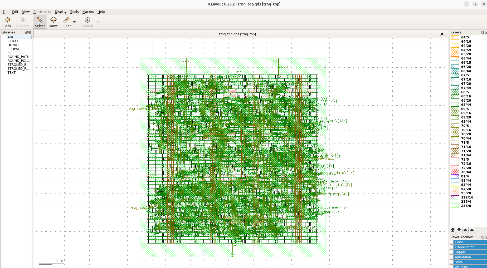
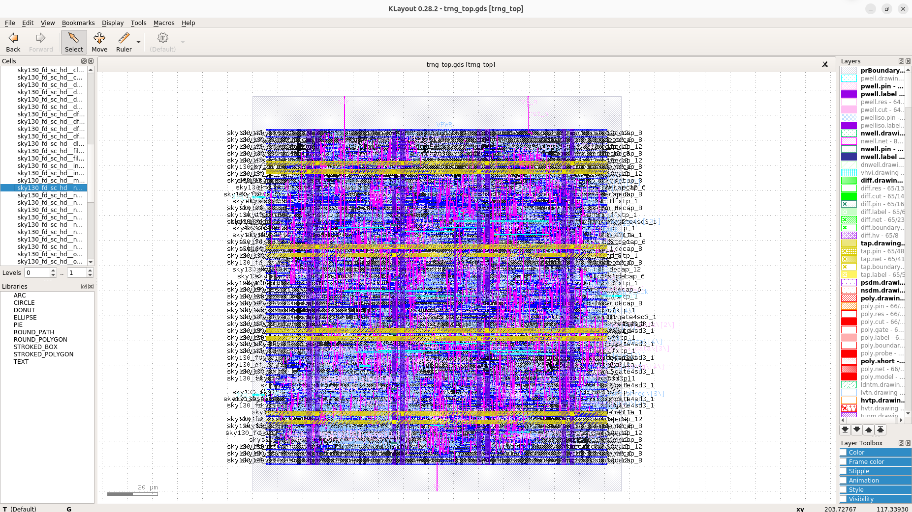
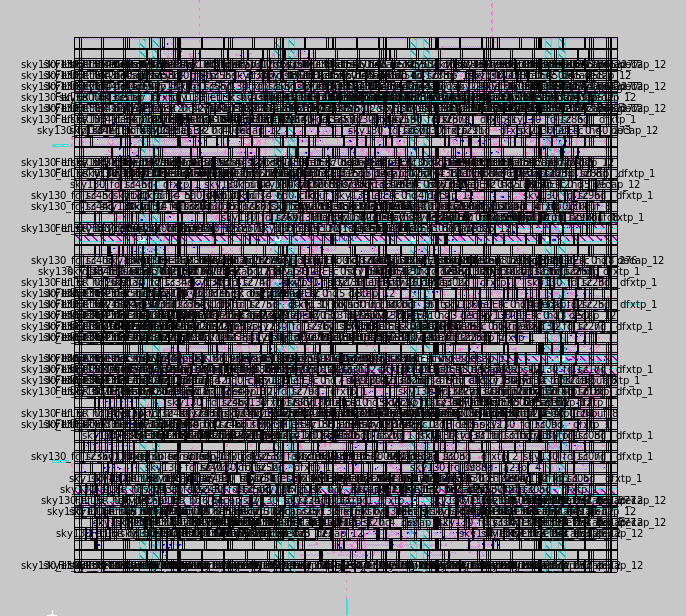

# Ring-Oscillator True Random Number Generator

A complete hardware TRNG project, starting from ring-oscillator RTL and extending through FPGA implementation, statistical testing, and ASIC physical design.



## Overview

The design generates raw random transitions with eight ring oscillators, combines them with XOR logic, captures them through a 2-flop asynchronous sampler, applies RCT and APT health checks, performs Von Neumann debiasing, packs output bytes, and transmits the result through UART.

**Ring oscillators → XOR → asynchronous sampler → health checks → Von Neumann correction → byte packer → UART 8-N-1**

The project demonstrates the complete digital flow across FPGA and ASIC implementations:

- **FPGA:** Verilog implementation, simulation, synthesis, timing, and power analysis with Xilinx Vivado
- **SKY130 ASIC:** RTL-to-GDSII implementation using OpenLane
- **90 nm ASIC:** Post-route implementation using Cadence Genus and Innovus
- **Randomness validation:** NIST SP 800-22 statistical testing

## Architecture

| Block | Function |
|---|---|
| Ring-oscillator bank | Generates jitter-driven transitions |
| XOR combiner | Combines the oscillator outputs |
| 2-flop sampler | Captures asynchronous transitions |
| RCT / APT | Monitors repetition and adaptive-proportion health |
| Von Neumann corrector | Reduces simple pairing bias |
| Byte packer | Produces 8-bit output values |
| UART transmitter | Sends output serially with 8-N-1 framing |

## FPGA Implementation

The FPGA design was simulated and implemented with Xilinx Vivado.


| Metric | Result |
|---|---:|
| Worst setup slack | +2.858 ns |
| Worst hold slack | +0.106 ns |
| Worst pulse-width slack | +4.500 ns |
| Setup / hold / pulse-width violations | 0 / 0 / 0 |
| Estimated on-chip power | 73 mW |

The FPGA run used a 100 MHz clock constraint. The power value is an estimate from Vivado, not a board-level measurement.

## SKY130 ASIC Implementation

The RTL-to-GDSII flow was completed for the SKY130A process with the `sky130_fd_sc_hd` standard-cell library.



The behavioral simulation displays reset, ring-oscillator activity, RCT/APT health monitoring, byte packing, and UART byte transmission.

| Metric | Result |
|---|---:|
| Process / library | SKY130A / sky130_fd_sc_hd |
| Clock constraint | 10 ns / 100 MHz |
| Setup / hold slack | +5.86 ns / +0.29 ns |
| Core utilization | 47.77% |
| Typical-corner power | 1.34 mW |
| Magic DRC violations | 0 |
| LVS mismatches | 0 |

### Layout and Verification Views

The final SKY130 layout and its KLayout and Magic views are included with the project:



| View | Description |
|---|---|
|  | KLayout view of the final GDSII |
|  | Magic DRC and layer view |

The 100 MHz value is the design constraint, not a demonstrated maximum operating frequency.

## 90 nm ASIC Implementation

A separate implementation was carried through synthesis and place-and-route with Cadence Genus and Innovus.


| Metric | Result |
|---|---:|
| Process / supply | 90 nm / 0.9 V |
| Tools | Genus 21.14 / Innovus 21.15 |
| Top-level instances | 679 |
| Reported setup slack | +6.009 ns |
| Post-route power | 0.37239906 mW, estimated |

The Cadence power value assumes the default activity settings used by the post-route power run. The archived set does not include a hold report or DRC/LVS signoff, so these items are not claimed here.

## NIST SP 800-22 Statistical Testing

The captured campaign processed:

- **55 binary bitstreams**
- **1,000,000 bits per stream**
- **55,000,000 bits in total**

The Frequency, Block Frequency, Cumulative Sums, Longest Run, FFT, Universal, Serial, and Linear Complexity families reported 55/55 passes in the captured table. One NonOverlapping Template row reported 51/55, below the approximate 52/55 proportion threshold.

NIST SP 800-22 provides statistical screening. It does not by itself certify the entropy source or establish cryptographic suitability.

## Run the Functional Simulation

Using Icarus Verilog:

```bash
iverilog -g2012 -DTRNG_BEHAV_SIM -s tb_trng_top \
  -o trng_sim openlane/src/trng_tech_cells.v \
  openlane/src/trng_top.v verification/tb_trng_top_rtl.v
vvp trng_sim
```

This is a behavioral RTL check. It confirms datapath and control behavior but does not model physical entropy or prove statistical randomness.

## Key Files

- [`rtl/trng_top.v`](rtl/trng_top.v) — FPGA implementation
- [`openlane/src/trng_top.v`](openlane/src/trng_top.v) — SKY130 implementation RTL
- [`openlane/physical/trng_layout.gds`](openlane/physical/trng_layout.gds) — final SKY130 GDSII
- [`results/nist/nist_sp80022_summary.txt`](results/nist/nist_sp80022_summary.txt) — statistical-testing summary

## License

Released under the [MIT License](LICENSE).
