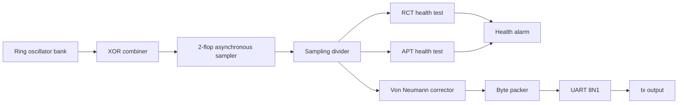

# FPGA-Based Hardware True Random Number Generator

## Cryptographic and Cybersecurity Applications

This repository presents an **FPGA-based hardware true random number generator (TRNG)** from RTL through FPGA evaluation and ASIC-oriented RTL-to-GDS implementation. It uses ring oscillators as a physical entropy source, asynchronous sampling, health monitoring, Von Neumann debiasing, byte packing, and UART output.

The project explores hardware entropy generation, Verilog RTL, FPGA implementation, statistical randomness validation, OpenLane/SKY130 physical design, Cadence implementation, and research evidence.

> **Security note:** This is a research project. Statistical tests and implementation reports do not by themselves establish a production cryptographic entropy source or certification. Production use requires an entropy model, environmental characterization, continuous health monitoring, secure integration, and appropriate certification.

## System architecture



Each oscillator is an enabled odd-inversion feedback loop. The FPGA implementation preserves the loop with Xilinx primitives and attributes. The portable/OpenLane implementation uses technology wrapper cells for a NAND enable gate and inverters. Distinct odd lengths are XORed, sampled by a two-flop synchronizer, checked by health tests, debiased, packed, and transmitted.

## Repository navigation

| Section | Location | Contents |
|---|---|---|
| RTL Design and Testbenches | [`Opensource_TRNG/design/src/`](Opensource_TRNG/design/src/), [`vivado/`](vivado/) | Portable RTL, FPGA RTL, technology wrappers, testbenches |
| FPGA Design and Vivado Results | [`vivado/`](vivado/) | Simulation, synthesis, implementation, timing, power, schematics |
| OpenLane Physical Design | [`openlane/`](openlane/), [`Opensource_TRNG/design/runs/`](Opensource_TRNG/design/runs/) | SKY130A RTL-to-GDS configuration and layout evidence |
| Cadence Results and Analysis | [`cadence/`](cadence/) | Genus/Innovus layout, netlist, timing/power evidence |
| NIST Randomness Testing | [`NIST/`](NIST/) | SP 800-22 campaign summary |
| Architecture and Block Diagrams | [`Diagrams/`](Diagrams/) | Pipeline, RO/sampler, timing, conditioning, evidence figures |
| Research Paper and Technical Documentation | [`paper_rerun/`](paper_rerun/), [`paper_rerun.zip`](paper_rerun.zip) | Final evidence bundle, scripts, verification, paper assets |

## RTL design and testbenches

- [`vivado/trng_top.v`](vivado/trng_top.v): FPGA `ro_cell`, repetition-count test, Von Neumann corrector, UART transmitter, and top-level integration.
- [`vivado/tb_trng.v`](vivado/tb_trng.v): 100 MHz functional testbench that counts raw samples, corrected bits, and UART byte requests.
- [`Opensource_TRNG/design/src/trng_top.v`](Opensource_TRNG/design/src/trng_top.v): portable RTL with reset synchronization, warm-up, RCT, APT, debug taps, and UART hand-off.
- [`Opensource_TRNG/design/src/trng_tech_cells.v`](Opensource_TRNG/design/src/trng_tech_cells.v): SkyWater, Cadence/GPDK, user, and behavioral technology wrappers.
- [`paper_rerun/paper_rerun/verification/tb/tb_trng_top_rtl.v`](paper_rerun/paper_rerun/verification/tb/tb_trng_top_rtl.v): behavioral functional verification; it explicitly does not measure entropy.
- [`Opensource_TRNG/design/config.json`](Opensource_TRNG/design/config.json), [`base.sdc`](Opensource_TRNG/design/constraints/base.sdc), and [`pin_order.cfg`](Opensource_TRNG/design/pin_order.cfg): OpenLane configuration and constraints.

## FPGA implementation and Vivado results

Evidence is in [`vivado/`](vivado/), including [schematics](vivado/TRNG_vivado_sch_whole.png), [simulation](vivado/TRNG_vivado_sim_1.png), [implementation](vivado/TRNG_vivado_impl.png), [timing](vivado/TRNG_vivado_timing_rpt.png), and [power](vivado/TRNG_vivado_power_rpt.png). See [`vivado/vivado_summary.txt`](vivado/vivado_summary.txt).

| Metric | Reported result |
|---|---:|
| Estimated total on-chip power | 73 mW |
| Dynamic / static power | 1 mW / 72 mW |
| Worst setup slack | +2.858 ns |
| Worst hold slack | +0.106 ns |
| Worst pulse-width slack | +4.500 ns |
| Timing failures | 0 setup, 0 hold, 0 pulse-width |

These are tool estimates and STA results; power is medium-confidence and not board-level measured power.

## OpenLane RTL-to-GDS results

See [`openlane/openlane_rtl_to_gds_summary.txt`](openlane/openlane_rtl_to_gds_summary.txt), [`openlane/trng_top.v`](openlane/trng_top.v), [`openlane/trng_tech_cells.v`](openlane/trng_tech_cells.v), [Magic evidence](openlane/SS03_magic.png), [layout evidence](openlane/SS04_Final_GDS_Layou.png), and [`Opensource_TRNG/design/runs/`](Opensource_TRNG/design/runs/).

| Metric | Reported result |
|---|---:|
| Flow / platform | Completed / SKY130A, `sky130_fd_sc_hd` |
| Clock constraint | 10 ns (100 MHz constraint) |
| Target / observed utilization | 45% / 47.77% |
| Final extracted setup / hold slack | +5.86 ns / +0.29 ns |
| Final extracted power | approximately 1.34 mW, typical-corner estimate |
| Detailed mapped top-module cells | 840 |
| Magic DRC / LVS | 0 reported violations / 0 reported errors |
| Router violations | 0 |

The checked-in summary states that final GDS is absent from the archived OpenLane report set; KLayout DRC and CVC metrics are `-1`/unavailable; wrapper-cell area is not fully accounted for; one unconstrained endpoint, four max-fanout violations, and eight intentional combinational loops are reported. The 100 MHz value is a constraint, not a demonstrated maximum frequency.

## Cadence implementation results

The [`cadence/`](cadence/) directory contains Genus/Innovus layout, netlist, pre/post-layout simulations, and [`cadence_rtl_to_gds_summary.txt`](cadence/cadence_rtl_to_gds_summary.txt).

| Metric | Reported result |
|---|---:|
| Tools / process | Genus 21.14, Innovus 21.15 / 90 nm |
| Supply | 0.9 V |
| Top-level instances | 679 |
| Reported total area | 4677.642 (unit not stated) |
| Shown setup slack | +6.009 ns |
| Post-route total power | 0.37239906 mW estimate |
| Clock constraint | 10 ns (100 MHz constraint) |

No Cadence DRC/LVS, hold report, die/core dimensions, or independent signoff summary is included. Power depends on default activity assumptions and is not a silicon measurement.

## NIST SP 800-22 statistical testing

[`NIST/nist_sp80022_summary.txt`](NIST/nist_sp80022_summary.txt) documents an STS campaign covering **55 binary bitstreams**, each **1,000,000 bits**, for **55,000,000 bits / 6,875,000 bytes** total. Primary evidence is identified as `collection_summary.json`, `SHA256_manifest.txt`, `TRNG_Terminal.txt`, and `TRNG_Terminal_Op.txt` from the analyzed archive.

The methodology captures long TRNG streams, partitions them into one-million-bit sequences, runs NIST SP 800-22, retains terminal output/metadata/hashes, and reviews per-test p-values and pass proportions. NIST SP 800-22 is statistical screening, not an entropy-source model or certification; the checked-in summary is authoritative for detailed per-test outcomes.

## Diagrams and research evidence

Available figures include the [pipeline](Diagrams/fig_pipeline.pdf), [RO sampler](Diagrams/fig_ro_sampler.pdf), [timing](Diagrams/fig_timing.pdf), [Von Neumann](Diagrams/fig_vonneumann.pdf), and [evidence](Diagrams/fig_evidence.pdf) diagrams. The paper bundle includes [`FINAL/`](paper_rerun/paper_rerun/FINAL/), [`collect_final.py`](paper_rerun/paper_rerun/scripts/collect_final.py), [`latest_run_tag.txt`](paper_rerun/paper_rerun/latest_run_tag.txt), and [KLayout](paper_rerun/paper_rerun/KLayout.png), [Magic](paper_rerun/paper_rerun/Magic.png), and [simulation](paper_rerun/paper_rerun/simulation.png) images.

## Tools and setup

Technologies include Verilog-2001, Xilinx Vivado, OpenLane/Yosys/OpenROAD, Magic, KLayout, Verilator, SKY130A, Cadence Genus/Innovus, and NIST SP 800-22.

For behavioral simulation with Icarus Verilog:

```bash
iverilog -g2012 -DTRNG_BEHAV_SIM -o trng_sim \
  Opensource_TRNG/design/src/trng_top.v \
  Opensource_TRNG/design/src/trng_tech_cells.v \
  paper_rerun/paper_rerun/verification/tb/tb_trng_top_rtl.v
vvp trng_sim
```

This is a functional check only. OpenLane and Cadence reruns require matching PDKs, libraries, licenses, and tool environments.

## Reproducibility and reporting guidance

Do not compare FPGA, OpenLane, and Cadence numbers without stating technology, supply, clock constraint, corner, activity assumptions, and whether a value is estimated or measured. Preserve the documented caveats around intentional oscillator loops, asynchronous sampling, unavailable signoff metrics, unqualified Cadence area units, and the difference between statistical testing and a formal entropy claim.

## License

No license file is currently provided. Treat RTL, reports, figures, and archives as project materials unless a separate license is supplied.
